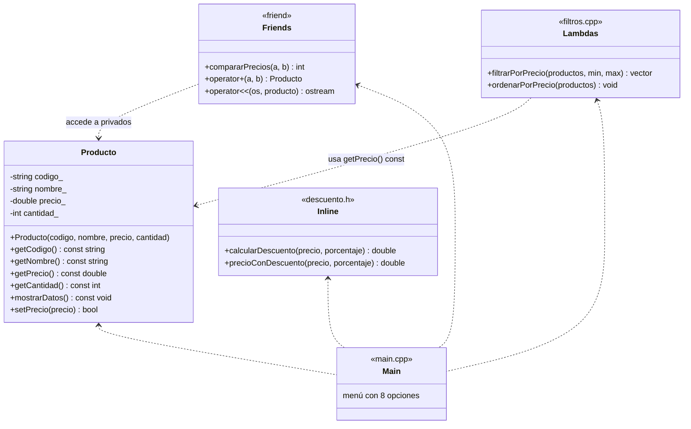

# Práctica 03 · Funciones en C++: inline, friend, const, lambda y sobrecarga de operadores

> **Grupo 1** · Universidad Nacional de San Agustín de Arequipa · Escuela Profesional de Ingeniería de Sistemas · 2026

| | |
|---|---|
| **Curso** | Tecnología de Objetos |
| **Docente** | Mg. Maribel Molina Barriga |
| **Lenguaje** | C++17 |
| **Entregables** | Práctica 1 (Áreas con funciones inline) · Sistema de Productos (todos los grupos) · Informe APA |

---

## Contenido
1. [Actividades asignadas](#actividades-asignadas)
2. [Reparto del trabajo](#reparto-del-trabajo)
3. [Estructura del repositorio](#estructura-del-repositorio)
4. [Compilar y ejecutar](#compilar-y-ejecutar)
5. [Diseño del Sistema de Productos](#diseño-del-sistema-de-productos)
6. [Resumen de conceptos](#resumen-de-conceptos)
7. [Flujo de trabajo en Git](#flujo-de-trabajo-en-git)
8. [Entrega](#entrega)

---

## Actividades asignadas

### Práctica 1 · Función inline: cálculo de áreas
**Objetivo:** aplicar funciones *inline* para optimizar operaciones matemáticas simples.
- Crear tres funciones inline: `areaCuadrado(lado)`, `areaRectangulo(base, altura)` y `areaCirculo(radio)`.
- Pedir al usuario las medidas e imprimir los resultados.
- **Reto:** menú para elegir la figura.
- **Puntaje:** 10 (5 ejecución correcta + 3 menú funcional + 2 presentación clara).

### Todos los grupos · Sistema de Productos
**Objetivo:** integrar todas las funciones del tema en un mini sistema.
- Función **inline** para calcular el descuento de un producto.
- Clase `Producto` con atributos **privados** y una función **friend** que compare precios.
- Funciones **const** para mostrar datos sin modificarlos.
- **Lambda** para filtrar productos por precio.
- Sobrecarga del operador **`+`** para combinar productos.
- **Reto:** sobrecarga del operador **`<<`** para mostrar el producto en formato legible.

## Reparto del trabajo

| Integrante | Parte | Concepto | Archivos | Rama |
|------------|-------|----------|----------|------|
| **Elkin** | Práctica 1: áreas | `inline` | `practica1-areas-inline/areas_inline.cpp` | `feature/practica1` |
| **Fernando** | Descuento y filtros | `inline` + `lambda` | `sistema-productos/include/descuento.h`, `src/filtros.cpp` | `feature/descuento-filtros` |
| **Gabriel** | Clase Producto | `const` + `friend` | `sistema-productos/src/producto.cpp` | `feature/producto` |
| **Diego** | Operadores | `operator+` + `operator<<` | `sistema-productos/src/operadores.cpp` | `feature/operadores` |
| **Jerry** | Menú e integración, documentación e informe | todos | `sistema-productos/src/main.cpp`, `docs/`, `informe/` | `main` |

Cada archivo tiene un bloque `TODO` con las indicaciones exactas. **No modifiquen `producto.h` ni `filtros.h`**: son el contrato entre las partes (en `descuento.h` Fernando solo cambia el cuerpo de las funciones).

### Checklist por integrante
- [ ] **Elkin:** 3 funciones `inline` · lectura de medidas · menú (reto) · resultados con 2 decimales · *(extra)* rechazar medidas negativas.
- [x] **Fernando:** `calcularDescuento` y `precioConDescuento` (inline) · `filtrarPorPrecio` con `std::copy_if` + lambda · `ordenarPorPrecio` con `std::sort` + lambda.
- [ ] **Gabriel:** getters `const` · `mostrarDatos() const` · `setPrecio` (no negativo) · `compararPrecios` (friend, accede a `precio_` directamente) · captura del error de compilación al modificar un atributo dentro de una función `const`.
- [ ] **Diego:** `operator+` (paquete con precios y cantidades sumados) · `operator<<` con el formato `[P001] Teclado mecánico | S/ 150.00 | stock: 10`.
- [ ] **Todos:** tomar las **capturas** de su parte según [`docs/pruebas.md`](docs/pruebas.md) y subirlas a `docs/capturas/`.

## Estructura del repositorio

```
prac03-funciones-cpp/
├── practica1-areas-inline/
│   └── areas_inline.cpp       Práctica 1 (Elkin)
├── sistema-productos/
│   ├── include/
│   │   ├── producto.h         Clase Producto (contrato)
│   │   ├── descuento.h        Funciones inline (Fernando)
│   │   └── filtros.h          Filtros con lambda (contrato)
│   └── src/
│       ├── main.cpp           Menú e integración (Jerry)
│       ├── producto.cpp       Funciones const y friend (Gabriel)
│       ├── operadores.cpp     operator+ y operator<< (Diego)
│       └── filtros.cpp        Lambdas (Fernando)
├── docs/
│   ├── conceptos.md           Dónde se aplica cada concepto
│   ├── pruebas.md             Casos de prueba
│   └── capturas/              Evidencias de ejecución
├── informe/                   Informe en formato APA (.docx)
└── Makefile
```

## Compilar y ejecutar

Requisito: compilador con C++17 (`g++` de MinGW en Windows, `clang++` en macOS o `g++` en Linux).

**Con make**
```bash
make                  # compila todo en bin/
make run-practica1    # ejecuta la Práctica 1
make run-sistema      # ejecuta el Sistema de Productos
```

**Sin make (Windows / cualquier sistema)**
```bash
g++ -std=c++17 -Wall practica1-areas-inline/areas_inline.cpp -o areas_inline
g++ -std=c++17 -Wall -Isistema-productos/include sistema-productos/src/*.cpp -o sistema_productos
```

> En Windows, si las tildes se ven mal en la consola, ejecuten `chcp 65001` antes del programa.

Mientras una parte no esté implementada, el sistema muestra `[pendiente: ...]` y **sigue funcionando**: cada uno puede probar su parte sin esperar a los demás.

## Diseño del Sistema de Productos



**Menú del sistema**

| Opción | Acción | Concepto aplicado |
|--------|--------|-------------------|
| 1 | Listar catálogo | `operator<<` |
| 2 | Ver detalle de un producto | función `const` |
| 3 | Comparar precios | función `friend` |
| 4 | Calcular descuento | función `inline` |
| 5 | Filtrar por rango de precio | `lambda` + `std::copy_if` |
| 6 | Combinar dos productos | `operator+` |
| 7 | Ordenar por precio | `lambda` + `std::sort` |
| 8 | Cambiar precio | función no `const` (contraste) |

## Resumen de conceptos

| Concepto | Palabra clave | Propósito | Dónde se usa |
|----------|---------------|-----------|--------------|
| Inline | `inline` | Optimizar funciones pequeñas | `areas_inline.cpp`, `descuento.h` |
| Friend | `friend` | Acceso a miembros privados | `compararPrecios`, `operator+`, `operator<<` |
| Constantes | `const` | Evitar modificaciones en el objeto | getters y `mostrarDatos()` |
| Lambda | `[ ]( ) { }` | Funciones anónimas rápidas | `filtrarPorPrecio`, `ordenarPorPrecio` |
| Sobrecarga | `operator` | Personalizar operadores | `operator+`, `operator<<` |

Detalle en [`docs/conceptos.md`](docs/conceptos.md).

## Flujo de trabajo en Git

```bash
git clone https://github.com/JerryCode777/prac03-funciones-cpp.git
cd prac03-funciones-cpp
git checkout -b feature/<tu-parte>       # ver la tabla de reparto
# ... implementar, compilar con make y probar ...
git add .
git commit -m "feat(<parte>): descripción breve"
git push -u origin feature/<tu-parte>
```
Luego abran un **Pull Request** hacia `main`. Antes de abrirlo, verifiquen que `make` compile **sin errores ni advertencias**.

## Entrega
- Código completo en `main`.
- Conceptos aplicados: [`docs/conceptos.md`](docs/conceptos.md).
- Casos de prueba y capturas: [`docs/pruebas.md`](docs/pruebas.md), [`docs/capturas/`](docs/capturas/).
- Informe en formato APA: [`informe/`](informe/).

## Integrantes
| Apellidos y nombres | Usuario GitHub |
|---------------------|----------------|
| Huaynacho Mango Jerry Anderson | JerryCode777 |
| Quispe Mamani Jose Gabriel | J-Gabriel-Quispe-M |
| Ramos Ochochoque Elkin Eder B. | elkinramos8 |
| Schreiber Landeo Diego Hans | Diego-Schreiber |
| Solsol Choque Fernando Rafael | Fernando-Solsol |
